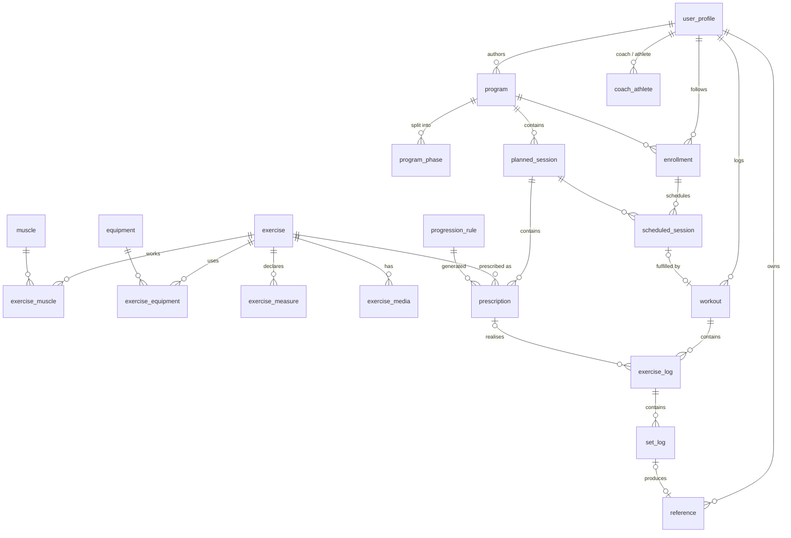

# Modèle de données V1

> Référence : document de specs v0.1. Ce fichier décrit le schéma relationnel de la V1 (SQLite local via `expo-sqlite` + Drizzle), pensé pour être synchronisé plus tard avec Supabase (Postgres) via PowerSync.

## 1. Conventions

| Règle | Détail | Pourquoi |
| --- | --- | --- |
| Identifiants | `id` = UUID v7 (texte) généré sur l'appareil | Pas de collision lors de la future synchro |
| Horodatage | `created_at`, `updated_at` (UTC, ms epoch, entier) sur chaque table | Résolution de conflits, synchro incrémentale |
| Suppression | `deleted_at` nullable (soft delete) | Propager les suppressions au serveur |
| Propriété | `owner_id` sur toute donnée utilisateur | Futures règles RLS Postgres |
| Dates calendaires | `YYYY-MM-DD` (texte, date locale) | Une séance du mardi reste un mardi, quel que soit le fuseau |
| Charges | Toujours stockées en **kg** (réel, peut être négatif pour un délestage) | Conversion lbs uniquement à l'affichage |
| Durées | Secondes (entier) | |
| Énumérations | Texte contraint (`CHECK`) côté SQLite, types TS côté code | Lisible en base, sûr en code |
| Nommage | `snake_case` en base, `camelCase` en TS (mapping Drizzle) | |

Les colonnes communes (`id`, `created_at`, `updated_at`, `deleted_at`) ne sont pas répétées dans les tables ci-dessous.

## 2. Vue d'ensemble

Trois blocs : **catalogue** (exercices, lecture seule en V1), **plan** (programme → séance prévue → prescription), **réalisation** (workout → exercise_log → set_log). L'**inscription** fait le pont entre plan et calendrier.

## 3. Catalogue (lecture seule en V1, seedé en base)

### `exercise`

| Colonne | Type | Notes |
| --- | --- | --- |
| `slug` | text unique | Clé stable pour le seed (`repeaters`, `max-hang`) |
| `name` | text | EN |
| `description` | text | |
| `instructions` | text | Consignes d'exécution |
| `category` | enum | `fingers`, `strength`, `climbing`, `mobility`, `conditioning`, `warmup` |
| `dosage_scheme` | enum | `reps`, `isometric`, `intervals`, `circuit`, `slots`, `free_duration` |
| `default_effort_scale` | enum | `rpe`, `rir`, `feel` |
| `unilateral_allowed` | bool | |
| `is_testable` | bool | Peut produire une `reference` (ex : max hang 10s) |

### Tables liées

| Table | Colonnes | Notes |
| --- | --- | --- |
| `muscle` | `slug` (unique), `name`, `body_region` | Liste fermée ; `body_region` : `arms`, `shoulders`, `back`, `chest`, `core`, `legs` |
| `exercise_muscle` | `exercise_id`, `muscle_id`, `role` (`primary` / `secondary`) | |
| `equipment` | `slug` (unique), `name` | Hangboard, barre, poulie, blocs... |
| `exercise_equipment` | `exercise_id`, `equipment_id` | |
| `exercise_measure` | `exercise_id`, `measure` | `load`, `grip`, `edge`, `grade`, `tempo`, `range`, `effort`, `result` : champs proposés à la prescription et au log |
| `exercise_media` | `exercise_id`, `kind` (`video` / `image`), `uri`, `sort` | Contenu à définir |
| `exercise_favorite` | `user_id`, `exercise_id` (unique ensemble) | Favoris de la bibliothèque. Retirer un favori remplit `deleted_at` ; le remettre réutilise la même ligne |

## 4. Utilisateurs

### `user_profile`

| Colonne | Type | Notes |
| --- | --- | --- |
| `display_name` | text | |
| `is_coach` | bool | Coach factice en V1 |
| `bodyweight_kg` | real nullable | Saisi une fois, sans historique |
| `weight_unit` | enum | `kg`, `lbs` |
| `boulder_grade_system` | enum | `font`, `v_scale` |
| `route_grade_system` | enum | `french`, `yds` |
| `prep_countdown_s` | int | Défaut 10 |
| `side_switch_rest_s` | int | Défaut 10 (unilatéral) |
| `theme` | enum | `dark`, `light`, `system` ; défaut `dark` |
| `timer_sounds_enabled` | bool | Défaut `true` |
| `timer_volume` | int | 0 à 100, défaut 100 |
| `haptics_enabled` | bool | Défaut `true` |

### `coach_athlete`

| Colonne | Type | Notes |
| --- | --- | --- |
| `coach_id` | fk user_profile | |
| `athlete_id` | fk user_profile | |
| `status` | enum | `active`, `ended` |
| `logs_visible` | bool | Défaut `true` (V2) |

## 5. Plan

### `program`

| Colonne | Type | Notes |
| --- | --- | --- |
| `owner_id` | fk user_profile | Auteur (athlète ou coach) |
| `athlete_id` | fk nullable | Destinataire ; null pour un template |
| `is_template` | bool | V2 |
| `template_id` | fk program nullable | Template d'origine d'une copie |
| `template_version` | int nullable | Version copiée ; modifier un template crée une nouvelle ligne avec `version + 1` |
| `name`, `description` | text | |
| `duration_days` | int | Calculé ou saisi |

### `program_phase`

| Colonne | Type | Notes |
| --- | --- | --- |
| `program_id` | fk | |
| `name` | text | Test, Base, Force, Deload |
| `start_week`, `end_week` | int | Bornes en `week_index` (incluses) |
| `is_test` | bool | |
| `sort` | int | |

### `planned_session`

| Colonne | Type | Notes |
| --- | --- | --- |
| `program_id` | fk | |
| `week_index` | int | 1 = première semaine |
| `day_of_week` | int | 1 = lundi ... 7 = dimanche (ISO 8601) |
| `sort` | int | Ordre si plusieurs séances le même jour |
| `name` | text nullable | |
| `is_test` | bool | |
| `notes` | text | |

> **Décision** : un programme commence toujours un lundi ; la semaine 1 va du lundi au dimanche. Les semaines ne sont pas une table : elles se déduisent de `week_index`.

### `prescription`

Une seule table pour tous les schémas : les colonnes non pertinentes restent nulles. Colonnes typées (plutôt que du JSON) pour pouvoir filtrer et calculer des stats en SQL.

| Groupe | Colonnes | Notes |
| --- | --- | --- |
| Lien | `planned_session_id`, `exercise_id`, `sort` | |
| Dosage | `sets`, `reps`, `duration_s`, `on_s`, `off_s`, `rest_between_sets_s`, `rounds`, `items_per_round`, `slot_duration_s`, `total_duration_s` | Selon `dosage_scheme` (voir §7) |
| Charge | `load_mode`, `load_value` | `load_mode` : `none`, `absolute`, `added`, `assisted`, `percent_reference` ; `load_value` en kg ou en % |
| Prise | `grip_type`, `finger_count`, `side` | Voir §8 |
| Support | `edge_mm`, `support_label` | |
| Autres | `tempo`, `target_grade`, `target_effort` | |
| Effort | `effort_scale` | Hérite de l'exercice, modifiable |
| Test | `is_test` | Le résultat crée une `reference` |
| Progression | `progression_rule_id` nullable | Prescription générée par une règle |
| Texte | `notes` | Note de l'auteur |

### `progression_rule`

| Colonne | Type | Notes |
| --- | --- | --- |
| `program_id` | fk | |
| `kind` | enum | `add_load_per_week`, `add_percent_per_week`, `percent_of_reference` |
| `value` | real | |

La règle est un **outil d'édition** : elle génère des prescriptions avec des valeurs fixes. Retoucher une valeur générée ne touche pas la règle.

## 6. Calendrier et réalisation

### `enrollment`

| Colonne | Type | Notes |
| --- | --- | --- |
| `athlete_id` | fk | |
| `program_id` | fk | |
| `start_date` | date | Toujours un lundi (contrainte vérifiée à l'écriture) |
| `status` | enum | `active`, `paused`, `completed`, `archived` |
| `paused_at` | date nullable | Date de mise en pause ; remis à null à la reprise |
| `color` | text nullable | Distinguer les programmes dans le calendrier |

### `scheduled_session`

Les dates réelles sont **matérialisées** à l'inscription : le dashboard et le calendrier font une simple requête par date.

| Colonne | Type | Notes |
| --- | --- | --- |
| `enrollment_id` | fk | |
| `planned_session_id` | fk | |
| `scheduled_date` | date | `start_date + (week_index - 1) * 7 + (day_of_week - 1)` (+ décalages) |

Règles :
- **Décalage** : toujours en **semaines entières**. `UPDATE scheduled_date = scheduled_date + 7 * n` pour les lignes sans workout lié dont la **semaine prévue** (`planned_session.week_index`) est `>=` à la semaine choisie. Les semaines précédentes et les séances déjà loguées ne bougent pas ; un mardi reste un mardi. La semaine affichée sur une séance (`Week 3 · Day 2`) vient de `week_index`, pas de la date, pour rester juste après un décalage.
- **Arrêt** : l'inscription passe en `archived` et ses lignes sans workout datées d'aujourd'hui ou après sont supprimées (suppression douce).
- **Programme modifié** : on régénère les lignes futures sans workout ; les séances déjà loguées gardent leur lien.
- **Pause** : tant que l'inscription est `paused`, ses lignes sans workout dont la date est `>= paused_at` sont masquées (Today, Calendar, stats d'assiduité) et ne deviennent jamais `missed`. Rien n'est décalé automatiquement : à la reprise, l'athlète choisit le décalage (voir `screens.md`, S7).
- **Statut** (dérivé, non stocké) : `in_progress` si un workout lié est commencé et non terminé, `done` si un workout lié est terminé ou contient au moins un exercice logué, `missed` si date passée sans workout, sinon `planned`. `in_progress` l'emporte sur `done`. Détail dans `screens.md` §3.2.

### `workout` (séance réalisée)

| Colonne | Type | Notes |
| --- | --- | --- |
| `athlete_id` | fk | |
| `scheduled_session_id` | fk nullable, unique | Null = séance libre. Valide la séance prévue **sans la déplacer** |
| `performed_on` | date | Date réelle (peut différer de `scheduled_date`) |
| `started_at`, `ended_at` | timestamp nullable | |
| `notes` | text | |

### `exercise_log`

| Colonne | Type | Notes |
| --- | --- | --- |
| `workout_id` | fk | |
| `exercise_id` | fk | |
| `prescription_id` | fk nullable | Null = exercice ajouté librement |
| `sort` | int | |
| Dosage (mêmes colonnes que `prescription`, §7) | | Dosage visé pour ce log : copié de la prescription, ou saisi pour un exercice libre. Figé ici, pour qu'une modification ultérieure du programme ne change jamais un log |
| `target_load_kg` | real nullable | Charge visée, résolue depuis la prescription |
| `grip_type`, `finger_count`, `side`, `edge_mm`, `support_label` | | Valeurs réellement utilisées |
| `effort_scale`, `effort_value` | | Effort global de l'exercice |
| `notes` | text | |

### `set_log`

Une ligne = une unité réalisée : un set (reps, isométrie, intervalles), un bloc dans un tour (circuit), un créneau (slots), ou un bloc réussi (durée libre).

| Colonne | Type | Notes |
| --- | --- | --- |
| `exercise_log_id` | fk | |
| `set_index` | int | Set, créneau ou numéro du bloc |
| `round_index`, `item_index` | int nullable | Circuit (4x4 : tour × bloc) |
| `side` | enum nullable | `left` / `right` si unilatéral alterné |
| `reps_done` | int nullable | |
| `duration_s` | int nullable | |
| `load_kg` | real nullable | Charge réelle (négative = délestage) |
| `grade`, `grade_system` | text nullable | Cotation saisie et système utilisé |
| `result` | enum | `success`, `fail` ; pré-rempli à `success` |
| `effort_value` | real nullable | Si effort par set |

### `reference` (résultats de tests)

Communes à tous les programmes de l'athlète.

| Colonne | Type | Notes |
| --- | --- | --- |
| `athlete_id` | fk | |
| `exercise_id` | fk | |
| `grip_type`, `finger_count`, `side`, `edge_mm`, `duration_s` | | **Clé de correspondance** avec une prescription en % |
| `value_kg` | real | Charge ajoutée (négative si délestage) |
| `measured_on` | date | |
| `source_set_log_id` | fk nullable | Set de test d'origine |

Une prescription `percent_reference` utilise la référence la plus récente qui a la même clé de correspondance. Sans référence : on affiche le %, et la charge reste vide.

## 7. Colonnes de dosage par schéma

| Schéma | Colonnes utilisées | Exemple |
| --- | --- | --- |
| `reps` | `sets`, `reps`, `rest_between_sets_s` | 4 × 5, 3 min |
| `isometric` | `sets`, `duration_s`, `rest_between_sets_s` | Max hang 10s × 6, 3 min |
| `intervals` | `sets`, `reps`, `on_s`, `off_s`, `rest_between_sets_s` | Repeaters 7s:7s × 5 × 6, 3 min |
| `circuit` | `rounds`, `items_per_round`, `rest_between_sets_s` | 4x4, 4 min |
| `slots` | `sets`, `slot_duration_s` | Volume boulder 3 min × 20 |
| `free_duration` | `total_duration_s` | Max effort climbing 60 min |

Une validation côté code (schéma Zod par `dosage_scheme`) garantit que les colonnes requises sont remplies.

## 8. Énumérations de prise

| Enum | Valeurs |
| --- | --- |
| `grip_type` | `half_crimp`, `full_crimp`, `open_drag`, `pocket`, `pinch`, `sloper` |
| `finger_count` | `four`, `three_front`, `three_back`, `two_front`, `two_middle`, `two_back`, `mono` |
| `side` | `both`, `left`, `right`, `alternate` |

## 9. Logique dérivée (code, pas de stockage)

| Besoin | Calcul |
| --- | --- |
| Pré-remplissage du log | 1) prescription (kg ou % × référence) → 2) dernier `exercise_log` du même exercice avec mêmes prise et bord : meilleure charge de ses sets réussis (`lastLoadKg`, affichée `+5 kg · last`) → 3) vide. S6 reprend aussi le dosage du dernier log de l'exercice |
| Statut d'une séance | `scheduled_session` + état du `workout` lié + pause de l'inscription (§6) |
| Stats max hangs | `set_log` des exercices `isometric` filtrés, groupés par prise × bord × durée ; % du poids de corps si `bodyweight_kg` est renseigné |
| Timer | Liste d'étapes générée depuis la prescription (préparation, ON, OFF, repos, changement de côté). L'état actif est persisté dans la table locale `active_timer` (une ligne, non synchronisée) pour que l'affichage se recale au retour au premier plan. Détail dans `timer.md` |

## 10. Implémentation

| Élément | Emplacement |
| --- | --- |
| Schéma Drizzle | `src/db/schema.ts` (énumérations dans `src/db/enums.ts`) |
| Migrations SQL générées | `drizzle/` ; régénérer avec `npm run db:generate` après toute modification du schéma |
| Validation des dosages (Zod) | `src/db/dosage.ts` |
| Seed | `src/db/seed/` : `catalog.ts` (muscles, équipement, exercices), `demo-program.ts` (coach factice et programme de démo) |
| Contrôle du seed | `npm run check:seed` applique les migrations et le seed à une base SQLite en mémoire, clés étrangères et contraintes `CHECK` actives |
| Requêtes | `src/db/queries/` ; les écrans les lisent avec `useDbQuery` (instantané `useSyncExternalStore` mis en cache par version), relu à chaque changement de la base et à chaque navigation |
| Tests | `npm test` : logique pure (timer, calendrier, charges) et un parcours complet en base (onboarding, séance de test, référence, charges en %, logs libres, inscriptions : décalage, pause, reprise, arrêt), sur une base SQLite en mémoire |

Le seed est chargé au premier lancement, quand la table `exercise` est vide. À l'onboarding, les programmes du coach factice sont rattachés à l'athlète et inscrits avec, pour date de début, le lundi de la semaine en cours.

Un workout est créé à la première action sur une séance (`Start session`, ou ouverture d'un exercice), avec un `exercise_log` par prescription : dosage, prise et charge résolue y sont copiés à ce moment-là.

## 11. Hors V1 (déjà prévu dans le schéma)

- `coach_athlete.logs_visible` et les champs template de `program` : utilisés en V2.
- Exercices custom : ajout futur de `exercise.owner_id` nullable (null = bibliothèque officielle).
- Chat, marketplace, abonnement : nouvelles tables, pas d'impact sur l'existant.
